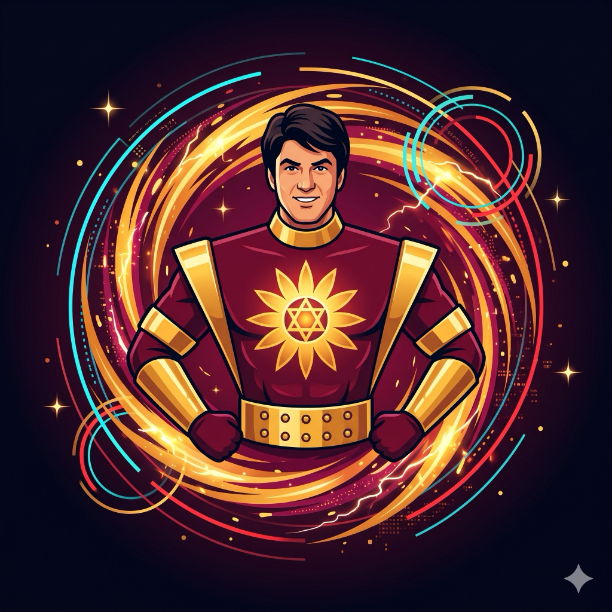

# Shaktiman Browser & Private Search Engine

<p align="center">
  
</p>

<p align="center">
  <b>High-dynamic desktop AI browser with BaseWindow zero-flicker WebContentsView architecture, private BM25 lexical ranking, live web metasearch via DDGS, and agentic AI sidebar automation.</b>
</p>

## Requirements

- Python 3.9+
- Node.js 18+
- Dependencies listed in `requirements.txt` and `package.json`

## Installation

```bash
python3 -m pip install -U -r requirements.txt
npm install
```

## Running the Application

### 1. Start Shaktiman Search Backend

```bash
python3 -m uvicorn app:app --host 0.0.0.0 --port 8000
```

### 2. Launch Shaktiman Desktop Browser

```bash
ELECTRON_RUN_AS_NODE= npm start
```

## Features

- **Official Shaktiman Brand Identity**: Integrated hero logo, window dock icon, and favicon.
- **Dual BM25 & Live Metasearch**: In-memory Okapi BM25 ranking paired with live DDGS metasearch fallback.
- **AI Synthesis & Overview**: Query synthesis with real hyperlinked sources and citations.
- **Funny Animals & Memes Wallpaper Engine**: Live dynamic backgrounds with Cats, Dogs, Memes, Mixed Chaos, and Aurora modes.
- **Agentic AI Studio**: Real-time DOM context extraction and autonomous browser action execution.
- **Privacy Shield & Burn Session**: Tracker and ad blocking with DuckDuckGo-style instant data burning.
